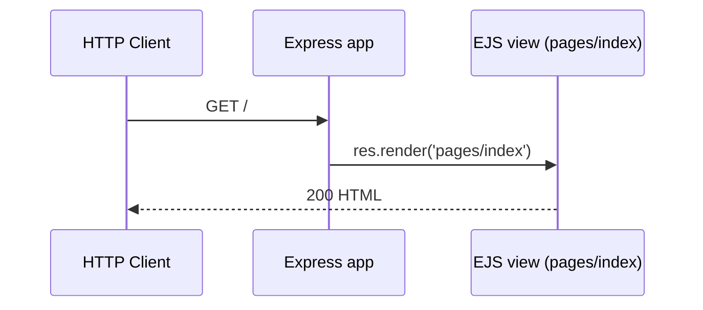
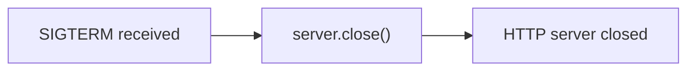

# nodejs-getting-started

A barebones Node.js app using [Express](https://expressjs.com/).

This application supports the tutorials for both the [Cedar and Fir generations](https://devcenter.heroku.com/articles/generations) of the Heroku platform. You can check them out here:

* [Getting Started on Heroku with Node.js](https://devcenter.heroku.com/articles/getting-started-with-nodejs)
* [Getting Started on Heroku Fir with Node.js](https://devcenter.heroku.com/articles/getting-started-with-nodejs-fir)

## Running Locally

Make sure you have [Node.js](http://nodejs.org/) and the [Heroku CLI](https://cli.heroku.com/) installed.

```sh
$ git clone https://github.com/heroku/nodejs-getting-started.git # or clone your own fork
$ cd nodejs-getting-started
$ npm install
$ npm start
```

Your app should now be running on [localhost:5006](http://localhost:5006/).

**Developer guide** — jump to the sections added below:

- [API Documentation](#api-documentation)
- [Application Architecture](#application-architecture)
- [Environment Variables](#environment-variables)
- [Testing](#testing)

> **Project Context** — This app is the nested **grandchild** submodule (`Submodule_02_Do_not_use_15Jun`) in a three-level Git submodule tree: the grandparent Python Koans project registers the `.gitignore`-templates child, which in turn registers this app. Source: .gitmodules:L1-L3; Submodule_01_Do_not_use_15Jun/.gitmodules:L1-L3. It is a Node.js/Express Heroku sample — its manifest declares the supported Node engines and the Express dependency, and the Heroku web dyno launches it with `node index.js`. Source: package.json:L5-L7, L13-L15; Procfile:L1. Navigate up to the parent [`.gitignore` templates submodule](../README.md) and the grandparent [Python Koans project](../../README.rst). These relative links resolve within the combined superproject checkout; if the submodules are not yet populated, run `git submodule update --init --recursive`.

## API Documentation

The app exposes a single HTTP endpoint that renders the landing page. Source: index.js:L42-L45.

| Method | Path | Description | Response |
| ------ | ---- | ----------- | -------- |
| `GET` | `/` | Renders the `pages/index` EJS view | `200 OK` (HTML) |

Source: index.js:L42-L45.

Once the app is running locally (see [Running Locally](#running-locally)), it listens on port `5006` by default (Source: index.js:L22), so you can exercise the route with:

```sh
curl http://localhost:5006/
```

The response is the fully rendered HTML landing page produced by `res.render('pages/index')`. Source: index.js:L42-L45.

## Application Architecture

The application is a small Express server that renders a single server-side view. Its runtime is composed of the following pieces:

- **Express bootstrap** — the application instance is created with `express()`. Source: index.js:L24.
- **Static assets** — files under `public/` (for example `lang-logo.png`, `node.svg`, and `stylesheets/main.css`) are served with `express.static`. Source: index.js:L26.
- **EJS view engine** — the `views/` directory is registered and `ejs` is set as the view engine, so `res.render('pages/index')` renders `views/pages/index.ejs`. Source: index.js:L27-L28.
- **HTTP listener** — `app.listen(port, ...)` starts the server and logs the port it is listening on. Source: index.js:L53-L55.
- **Keep-Alive tuning** — `server.keepAliveTimeout` is set to `95 * 1000` (95 seconds), intentionally longer than the Heroku Router's 90-second Keep-Alive idle timeout. This ensures the **router** (not the Node.js server) always initiates closing an idle connection, and it avoids a race condition where the router forwards a request just as Node.js is closing the socket. Source: index.js:L57-L63.
- **Graceful shutdown** — a `SIGTERM` handler calls `server.close()` so the server stops accepting new connections and lets in-flight requests finish before the process exits. Source: index.js:L75-L83.

The following diagram shows how an incoming `GET /` request is served. Source: index.js:L42-L45.



On `SIGTERM`, the server shuts down gracefully. Source: index.js:L75-L83.



## Environment Variables

| Variable | Default | Description | Source |
| -------- | ------- | ----------- | ------ |
| `PORT` | `5006` | HTTP listen port; read from the `PORT` environment variable, falling back to `5006` when unset | index.js:L22 |
| `TIMES` | `2` | Demo value present in the checked-in `.env` file | .env:L5 |

> **Note:** The `.env` file is committed **for demonstration purposes only**. For real projects, add `.env` to your `.gitignore` and remove it from the git cache with `git rm --cached .env`. Source: .env:L1-L4.

## Testing

Automated tests are written with [Jest](https://jestjs.io/) and run via `npm test`. Source: package.json:L9-L12.

The `getting started guide` suite boots the app with `node index.js`, then issues `GET /` requests over both IPv4 (`http://127.0.0.1:${PORT}`) and IPv6 (`http://[::1]:${PORT}`), asserting an HTTP `200` status and that the response body contains the page title and heading. Source: test.js:L32-L64. Each request is made through a small Promise-based `get(url)` helper. Source: test.js:L86-L103.

A representative assertion from the suite:

```js
const response = await get(`http://127.0.0.1:${PORT}`)
expect(response.statusCode).toBe(200)
expect(response.body).toMatch("<title>Node.js Getting Started on Heroku</title>")
```

Source: test.js:L51-L53.

Run the full suite with:

```sh
npm test
```

## Deploying to Heroku

Using resources for this example app counts towards your usage. [Delete your app](https://devcenter.heroku.com/articles/heroku-cli-commands#heroku-apps-destroy) and [database](https://devcenter.heroku.com/articles/heroku-postgresql#removing-the-add-on) as soon as you are done experimenting to control costs.

### Deploy on [Cedar][cedar]

By default, apps use Eco dynos on [Cedar][cedar] if you are subscribed to Eco. Otherwise, it defaults to Basic dynos. The 
Eco dynos plan is shared across all Eco dynos in your account and is recommended if you plan on deploying many small apps 
to Heroku. Learn more about our low-cost plans [here](https://blog.heroku.com/new-low-cost-plans).

Eligible students can apply for platform credits through our new [Heroku for GitHub Students program](https://blog.heroku.com/github-student-developer-program).

```
$ heroku create
$ git push heroku main
$ heroku open
```

### Deploy on [Fir][fir]

By default, apps on [Fir][fir] use 1X-Classic dynos. To create an app on [Fir][fir] you'll need to 
[create a private space](https://devcenter.heroku.com/articles/working-with-private-spaces#create-a-private-space)
first.

```
$ heroku spaces:create <space-name> --team <team-name> --generation fir
$ heroku create --space <space-name>
$ git push heroku main
$ heroku open
```

## Documentation

For more information about using Node.js on Heroku, see these Dev Center articles:

- [Getting Started on Heroku with Node.js](https://devcenter.heroku.com/articles/getting-started-with-nodejs)
- [Getting Started on Heroku Fir with Node.js](https://devcenter.heroku.com/articles/getting-started-with-nodejs-fir)
- [Heroku Node.js Support](https://devcenter.heroku.com/articles/nodejs-support)
- [Node.js on Heroku](https://devcenter.heroku.com/categories/nodejs)
- [Best Practices for Node.js Development](https://devcenter.heroku.com/articles/node-best-practices)
- [Using WebSockets on Heroku with Node.js](https://devcenter.heroku.com/articles/node-websockets)

[cedar]: https://devcenter.heroku.com/articles/generations#cedar
[fir]: https://devcenter.heroku.com/articles/generations#fir
