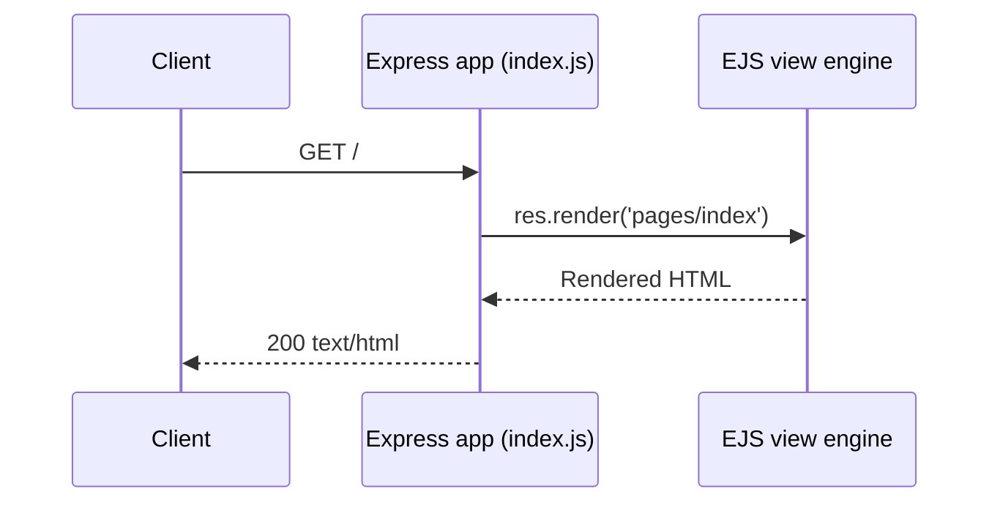
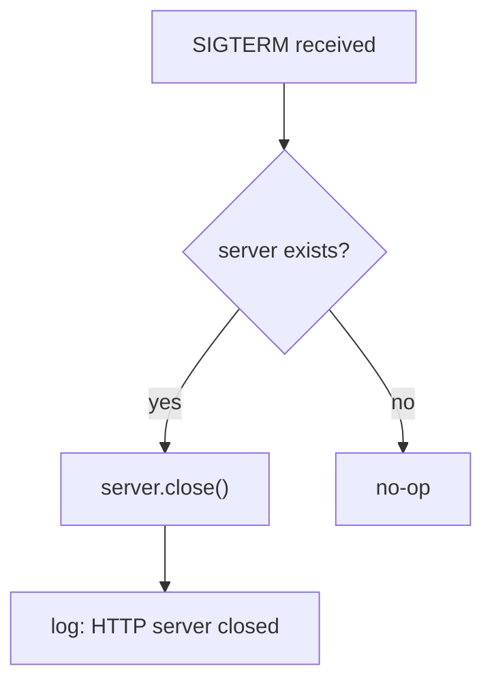

# nodejs-getting-started

A barebones Node.js app using [Express](https://expressjs.com/).

This application supports the tutorials for both the [Cedar and Fir generations](https://devcenter.heroku.com/articles/generations) of the Heroku platform. You can check them out here:

* [Getting Started on Heroku with Node.js](https://devcenter.heroku.com/articles/getting-started-with-nodejs)
* [Getting Started on Heroku Fir with Node.js](https://devcenter.heroku.com/articles/getting-started-with-nodejs-fir)

> **Note:** The Heroku Fir tutorial linked above is served from an access-gated
> area of the Heroku Dev Center and may return an authorization prompt
> (HTTP 401) unless you are signed in to a Heroku account with Fir access. The
> Cedar tutorial and all other Dev Center links referenced in this README remain
> publicly accessible.

## Table of Contents

- [Setup](#setup)
- [Running Locally](#running-locally)
- [API Reference](#api-reference)
- [Environment Variables](#environment-variables)
- [Testing](#testing)
- [Deploying to Heroku](#deploying-to-heroku)
- [Inline Code Explanations](#inline-code-explanations)
- [Documentation](#documentation)

## Setup

This app targets Node.js **`20.x || 22.x || 24.x`**. Source: package.json:L5-L7. Only Node.js is required to install the dependencies and run the app locally. The [Heroku CLI](https://cli.heroku.com/) is **optional** — it is needed only for deployment (see [Deploying to Heroku](#deploying-to-heroku)) or for running Heroku-specific commands, so the mention of it under [Running Locally](#running-locally) applies only when you intend to deploy.

Install the dependencies and start the server:

```sh
npm install && npm start
```

`npm start` runs `node index.js`. Source: package.json:L10. By default the app is then served at **`http://localhost:5006`**. Source: index.js:L31.

Run the automated test suite (see [Testing](#testing) for details):

```sh
npm test
```

`npm test` runs Jest. Source: package.json:L11.

**Dependencies** (documented here; this guide does not modify them):

| Package | Version | Type | Source |
| ------- | ------- | ---- | ------ |
| `express` | `^5.2.1` | runtime | package.json:L15 |
| `ejs` | `^6.0.1` | runtime | package.json:L14 |
| `jest` | `^30.4.2` | dev | package.json:L18 |

The app is released under the **MIT** license. Source: package.json:L29.

## Running Locally

Make sure you have [Node.js](http://nodejs.org/) and the [Heroku CLI](https://cli.heroku.com/) installed.

> **Local prerequisites:** Only [Node.js](https://nodejs.org/) is required to clone, install, and run the app locally with the commands below. The [Heroku CLI](https://cli.heroku.com/) is **optional** and is needed only when you deploy (see [Deploying to Heroku](#deploying-to-heroku)) or run Heroku-specific commands.

```sh
$ git clone https://github.com/heroku/nodejs-getting-started.git # or clone your own fork
$ cd nodejs-getting-started
$ npm install
$ npm start
```

Your app should now be running on [localhost:5006](http://localhost:5006/).

**Developer guide** — jump to the sections added below:

- [API Reference](#api-reference)
- [Environment Variables](#environment-variables)
- [Testing](#testing)
- [Inline Code Explanations](#inline-code-explanations)

> **Project Context** — This app is the nested **grandchild** submodule (`Submodule_02_Do_not_use_15Jun`) in a three-level Git submodule tree: the grandparent Python Koans project registers the `.gitignore`-templates child, which in turn registers this app. Source: ../../.gitmodules:L1-L3; ../.gitmodules:L1-L3. It is a Node.js/Express Heroku sample — its manifest declares the supported Node engines and the Express dependency, and the Heroku web dyno launches it with `node index.js`. Source: package.json:L5-L7, L13-L15; Procfile:L1. Navigate up to the parent [`.gitignore` templates submodule](../README.md) and the grandparent [Python Koans project](../../README.rst). These relative links resolve within the combined superproject checkout; if the submodules are not yet populated, run `git submodule update --init --recursive`.

## API Reference

The application exposes exactly one public HTTP endpoint. The `GET /` route responds with `200 text/html`, and the body is rendered from the EJS template `pages/index` (i.e. `views/pages/index.ejs`). Source: index.js:L67-L70. The rendered page includes the title `<title>Node.js Getting Started on Heroku</title>` (Source: views/partials/header.ejs:L1) and the heading `Getting Started on Heroku with Node.js` (Source: views/pages/index.ejs:L16) — exactly what the Jest suite asserts. Source: test.js:L115-L137.

| Method | Path | Request params | Response status | Content-Type | Body source |
| ------ | ---- | -------------- | --------------- | ------------ | ----------- |
| GET | `/` | none | `200` | `text/html` | EJS template `pages/index` (Source: index.js:L67-L70) |

The following sequence shows how a `GET /` request is served:



Once the app is running locally (see [Running Locally](#running-locally)), it listens on port `5006` by default (Source: index.js:L31), so you can exercise the route with:

```sh
curl http://localhost:5006/
```

The response is the fully rendered HTML landing page produced by `res.render('pages/index')`. Source: index.js:L67-L70.

## Environment Variables

| Variable | Default | Description | Source |
| -------- | ------- | ----------- | ------ |
| `PORT` | `5006` | HTTP listen port; read from the `PORT` environment variable, falling back to `5006` when unset | index.js:L31 |
| `TIMES` | `2` | Demo value present in the checked-in `.env` file | .env:L5 |

> **`PORT` is not defined in `.env`.** The checked-in `.env` file sets only `TIMES=2` (Source: .env:L5); it does **not** declare `PORT`. At runtime `PORT` is therefore taken from the process environment (for example, the value Heroku injects into the dyno), and when that variable is unset the server falls back to `5006` in code. Source: index.js:L31.

> **Note:** The `.env` file is committed **for demonstration purposes only**. For real projects, add `.env` to your `.gitignore` and remove it from the git cache with `git rm --cached .env`. Source: .env:L1-L4.

## Testing

Automated tests are written with [Jest](https://jestjs.io/) and run via `npm test`. Source: package.json:L9-L12.

The `getting started guide` suite boots the app with `node index.js`, then issues `GET /` requests over both IPv4 (`http://127.0.0.1:${PORT}`) and IPv6 (`http://[::1]:${PORT}`), asserting an HTTP `200` status and that the response body contains the page title and heading. Source: test.js:L48-L138. Each request is made through a small Promise-based `get(url)` helper. Source: test.js:L161-L210.

A representative assertion from the suite:

```js
const response = await get(`http://127.0.0.1:${PORT}`)
expect(response.statusCode).toBe(200)
expect(response.body).toMatch("<title>Node.js Getting Started on Heroku</title>")
```

Source: test.js:L116-L118.

Run the full suite with:

```sh
npm test
```

## Deploying to Heroku

Using resources for this example app counts towards your usage. [Delete your app](https://devcenter.heroku.com/articles/heroku-cli-commands#heroku-apps-destroy) and [database](https://devcenter.heroku.com/articles/heroku-postgresql#removing-the-add-on) as soon as you are done experimenting to control costs.

### Deploy on [Cedar][cedar]

By default, apps use Eco dynos on [Cedar][cedar] if you are subscribed to Eco. Otherwise, it defaults to Basic dynos. The 
Eco dynos plan is shared across all Eco dynos in your account and is recommended if you plan on deploying many small apps 
to Heroku. Learn more about our low-cost plans [here](https://blog.heroku.com/new-low-cost-plans).

Eligible students can apply for platform credits through our new [Heroku for GitHub Students program](https://blog.heroku.com/github-student-developer-program).

```
$ heroku create
$ git push heroku main
$ heroku open
```

### Deploy on [Fir][fir]

By default, apps on [Fir][fir] use 1X-Classic dynos. To create an app on [Fir][fir] you'll need to 
[create a private space](https://devcenter.heroku.com/articles/working-with-private-spaces#create-a-private-space)
first.

```
$ heroku spaces:create <space-name> --team <team-name> --generation fir
$ heroku create --space <space-name>
$ git push heroku main
$ heroku open
```

### Deployment Notes

The Heroku web process is declared by the `Procfile`, which starts the app with `web: node index.js`. Source: Procfile:L1. For `app.json`-based provisioning (for example the "Deploy to Heroku" button), the app selects the `heroku/nodejs` builder image. Source: app.json:L6.

> **Version note:** The `app.json` description text still reads "Express 4". Source: app.json:L3. The app actually depends on **Express `^5.2.1`**. Source: package.json:L15. Treat `^5.2.1` as authoritative; the `app.json` descriptor text is stale and does not affect the installed dependency.

## Inline Code Explanations

The source files carry [JSDoc](https://jsdoc.app/) annotations for every function and callback, so the most detailed, parameter- and return-level documentation lives beside the code. In `index.js` this covers the `GET /` route handler, the `app.listen` bootstrap callback, and the `SIGTERM` handler together with its `server.close` completion callback. Source: index.js:L56-L70, index.js:L72-L83, index.js:L106-L131. In `test.js` it covers the module's `describe`/`beforeEach`/`afterEach`/`it` lifecycle, the Promise-based `get(url)` helper, and every inline callback within them — the stdout forwarder, the startup Promise executor, the `get` Promise executor, the HTTP response callback, and the response `data` and `end` handlers. Source: test.js:L48-L210. Read those blocks alongside the summaries below.

**Application components.** The server is assembled in `index.js` from a few pieces:

- **Express bootstrap** — the application instance is created with `express()`. Source: index.js:L40.
- **Static assets** — files under `public/` (for example `lang-logo.png`, `node.svg`, and `stylesheets/main.css`) are served with `express.static`. Source: index.js:L52.
- **EJS view engine** — the `views/` directory is registered and `ejs` is set as the view engine, so `res.render('pages/index')` renders `views/pages/index.ejs`. Source: index.js:L53-L54.
- **HTTP listener** — `app.listen(port, ...)` starts the server and logs the port it is listening on. Source: index.js:L81-L83.

**Request flow.** Express receives `GET /`, the route handler logs the render and calls `res.render('pages/index')`, the EJS view engine renders the HTML, and Express returns `200 text/html`. Source: index.js:L67-L70.

**Graceful-shutdown flow.** On `SIGTERM` (sent by Heroku when a dyno is cycled or scaled down), the handler logs receipt and, if the server exists, calls `server.close(...)`, which logs `HTTP server closed` once in-flight requests have drained. Source: index.js:L118-L131. The server's `keepAliveTimeout` is set to `95 * 1000` (95 seconds) — deliberately longer than the Heroku Router's 90-second Keep-Alive idle timeout, so the router (not the Node.js server) always initiates closing an idle connection. Source: index.js:L98-L104.



## Documentation

For more information about using Node.js on Heroku, see these Dev Center articles:

- [Getting Started on Heroku with Node.js](https://devcenter.heroku.com/articles/getting-started-with-nodejs)
- [Getting Started on Heroku Fir with Node.js](https://devcenter.heroku.com/articles/getting-started-with-nodejs-fir)
- [Heroku Node.js Support](https://devcenter.heroku.com/articles/nodejs-support)
- [Node.js on Heroku](https://devcenter.heroku.com/categories/nodejs)
- [Best Practices for Node.js Development](https://devcenter.heroku.com/articles/node-best-practices)
- [Using WebSockets on Heroku with Node.js](https://devcenter.heroku.com/articles/node-websockets)

[cedar]: https://devcenter.heroku.com/articles/generations#cedar
[fir]: https://devcenter.heroku.com/articles/generations#fir
